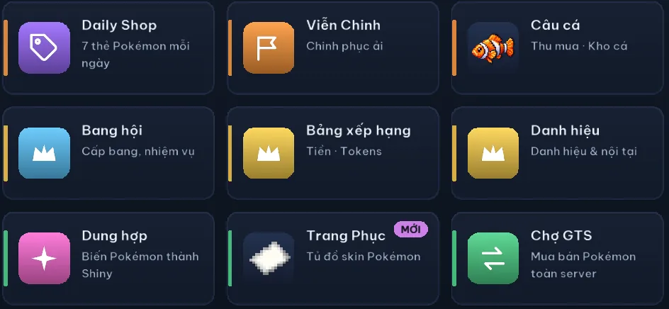
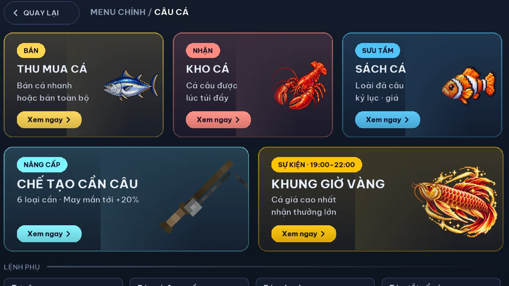
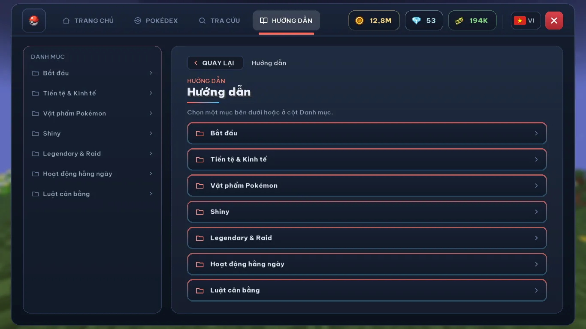

# Coco Cobblemon features

The main things to do on the server, based on the in-game guide. Times are Vietnam time (UTC+7).
{: .fs-5 .fw-300 }

## Ranked battles

Open it with `/xephang` or the RANKED tile in the main menu.

- **4v4 Doubles** (main format): bring 6, see the opponent's team, pick 4. Elo-rated, with a ban list (Regulation H: no Legendary, Mythical, Restricted, Paradox or Ultra Beast; Mega and Tera only).
- **6v6 Singles** (casual): all 6 fight, and only wins and losses are counted.
- Matchmaking uses hidden Elo. Teams fight as Lv 50 copies, with 90 seconds per turn.
- Ranks: Bronze, Silver, Gold, Platinum, Diamond, Master, each split into 3 tiers. The top 5 Masters become Challengers.

## Battle Tower

- 555 floors of 6v6 battles against NPCs. You need 6 Pokémon in your party.
- A boss floor every 5 floors; bosses use Mega, Dynamax, Tera and Z-Moves.
- From floor 15 on, some floors stop you from using one or more of those mechanics.
- If you lose, you drop 5 floors, but never below a checkpoint (25, 50, 75...).
- Rewards: BattleTower Points every day based on your highest floor (x3 on weekends), plus Tokens for each new checkpoint and per hour online.

## Guilds

- **Guild Wars:** every day, 9:00-22:00. Guilds raise a War Flag and challenge each other to 4v4 Doubles at Lv 50 to steal flags. Whoever holds the most flags at 22:00 is the day's Overlord.
- **Guild Boss:** every guild gets a new boss each day at 0:00 (Pseudo, Paradox or Ultra Beast on weekdays, Legendary on weekends), 3 attempts per member.
- **Guild gifts:** when someone catches a Shiny or a Legendary, or clears a Battle Tower checkpoint, everyone else in the guild gets a gift box.
- **Guild aura:** with 3 or more members online, everyone online gets +10% battle EXP and +10% catch rate.
- **Private land lock:** with `/dat khoa`, only you and up to 30 players you trust can use your land.

## World Raids

- Every day at 9:00 and 19:00 in the Lobby, open for 2 hours. You need a Raid Key to join (`/raid join`).
- Everyone hits the same HP pool, which depends on the boss type: Legendary 5,000, Sub-legendary 4,500, Ultra Beast 3,500, Paradox 3,000, Pseudo 2,500.
- The top 5 by damage get 3 catch attempts each, and whoever lands the last hit gets 3 more. Raid bosses have a 1/4096 Shiny chance.

## Legendary and Shiny

- **Accumulating Legendary chance:** starts at 0.001% and rises by 0.001% every 20 minutes without a natural Legendary spawn on the server, up to 1%. It resets as soon as one spawns anywhere.
- **Golden Hours:** Saturday and Sunday, 20:00-22:00, the current chance is doubled (up to 2%).
- **Summoning:** altars and shrines still work, but they cost CobbleDollars. Mythicals can't be summoned.
- **Shiny Pokémon do not spawn naturally.** Get them from Shiny Fusion, Pokémon Eggs (1/4096 to 1/512), World Raids, the Daily Shop (1/2048) and the Battle Pass.

## Daily play

- **Battle Pass:** 100 levels, 10 daily and 10 weekly quests, and free rewards every 5 levels.
- **Jobs** (`/nghenghiep`): 8 jobs, each with 5 quests a day, paying 1,000$ to 10,000$ per quest.
- **Expeditions:** send Pokémon on 1★ to 5★ missions, 3 runs a day. The timer keeps going at half speed while you're offline.
- **Daily Shop:** 7 random Lv 50 Pokémon cards every day.
- **Fishing:** 100 fish species across 7 rarities, a collection book, rods you can craft, and a golden hour contest twice a day, 11:00-13:00 and 19:00-22:00.
- **Mini-games:** Tiến Lên (a Vietnamese card game), a Monopoly-style board game and chess with Elo.

## In-game screens

<figure class="coco-gallery__wide"><figcaption>Main menu (Vietnamese): each tile opens a feature, such as the Daily Shop, Expeditions, Fishing, Guilds, Shiny Fusion and the GTS market.</figcaption></figure>
<figure><figcaption>Fishing: sell fish, fish storage, the collection book, rod crafting and the 19:00-22:00 golden hour.</figcaption></figure>
<figure><figcaption>The in-game guide, by topic: getting started, currencies, Pokémon items, Shiny, Legendary and Raids.</figcaption></figure>

*Screenshots from 28 and 30 October 2026, with the menu in Vietnamese (`/ngonngu en` switches it to English). The numbers in the top bar are just the balance of the account we took them on.*

## Quick answers

### What can you do on Coco Cobblemon?

For battling: ranked matches with Elo, the 555-floor Battle Tower and World Raids. For collecting: a Legendary chance that builds up over time and several ways to get Shinies. On top of that there are guilds with Guild Wars and Guild Bosses, and daily stuff like the Battle Pass, jobs, expeditions and fishing.

### Which features run at fixed times?

All in Vietnam time (UTC+7): World Raids at 9:00 and 19:00 every day, Guild Wars every day from 9:00 to 22:00, the fishing golden hour twice a day (11:00-13:00 and 19:00-22:00), and Legendary Golden Hours on Saturday and Sunday from 20:00 to 22:00. The Guild Boss, daily Battle Pass quests, jobs, expeditions and the Daily Shop all reset at 0:00.

**See also:** [Cobblemon server in Vietnam](/en/vietnam-cobblemon-server/) · [How to join](/en/how-to-join/) · [Download CocoLauncher](/en/cocolauncher/) · [FAQ](/en/faq/)

*Based on the in-game guide from 06/11/2026. Numbers can change with updates; if something here disagrees with the in-game menu, trust the menu.*
