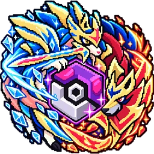
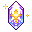



<h1 id="coco-cobblemon-a-cobblemon-server-in-vietnam">Coco Cobblemon: a Cobblemon server in Vietnam</h1>

A Vietnamese Pokémon Minecraft server. Java 1.21.1, Cobblemon 1.7.3, free to join with CocoLauncher.

Server address <code class="coco-ip__addr">coco.ultramc.co</code> <button type="button" class="coco-copy" data-copy="coco.ultramc.co" data-done="Copied"><svg aria-hidden="true"><use href="#ci-content-copy"/></svg>Copy</button>

<a class="coco-btn coco-btn--green" href="/en/cocolauncher/"><svg aria-hidden="true"><use href="#ci-download"/></svg>Download CocoLauncher</a>
<a class="coco-btn coco-btn--purple" href="https://discord.gg/hyspace"><svg aria-hidden="true"><use href="#ci-forum"/></svg>Join Discord</a>
<a class="coco-btn coco-btn--ghost" href="/en/how-to-join/"><svg aria-hidden="true"><use href="#ci-login"/></svg>How to join</a>
<a class="coco-btn coco-btn--ghost" href="/en/pokedex/">Pokédex</a>

## What you can do on Coco

<ul class="coco-cards">
<li>

<h3 class="no_anchor"><a href="/en/pokedex/">Pokédex</a></h3>
Look up Pokémon, abilities, items, natures, type matchups and drops, as they are on the server.

</li>
<li>
<svg aria-hidden="true"><use href="#ci-swords"/></svg>
<h3 class="no_anchor"><a href="/en/features/#ranked-battles">Ranked battles</a></h3>
4v4 Doubles with Elo and 6v6 Singles, with automatic matchmaking.

</li>
<li>

<h3 class="no_anchor"><a href="/en/features/#world-raids">World Raids</a></h3>
A shared boss for the whole server at 9:00 and 19:00 every day.

</li>
<li>

<h3 class="no_anchor"><a href="/en/features/#legendary-and-shiny">Accumulating Legendary chance</a></h3>
The longer the server goes without a Legendary, the higher the chance.

</li>
<li>

<h3 class="no_anchor"><a href="/en/features/#legendary-and-shiny">Shiny</a></h3>
Get Shiny Pokémon from Fusion, Eggs, Raids and the Battle Pass.

</li>
<li>
<svg aria-hidden="true"><use href="#ci-groups"/></svg>
<h3 class="no_anchor"><a href="/en/features/#guilds">Guilds</a></h3>
Guild Wars, a daily Guild Boss and private land locks.

</li>
<li>
<svg aria-hidden="true"><use href="#ci-calendar-month"/></svg>
<h3 class="no_anchor"><a href="/en/features/#daily-play">Daily play</a></h3>
Battle Pass, jobs, expeditions, fishing and daily rewards.

</li>
</ul>

<a href="/en/features/">See all features →</a>

