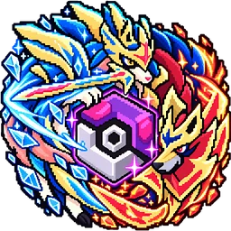
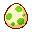
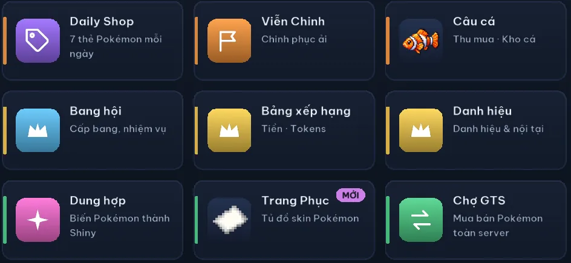
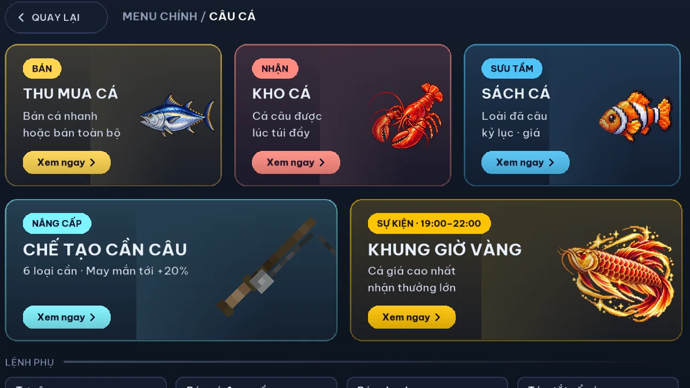
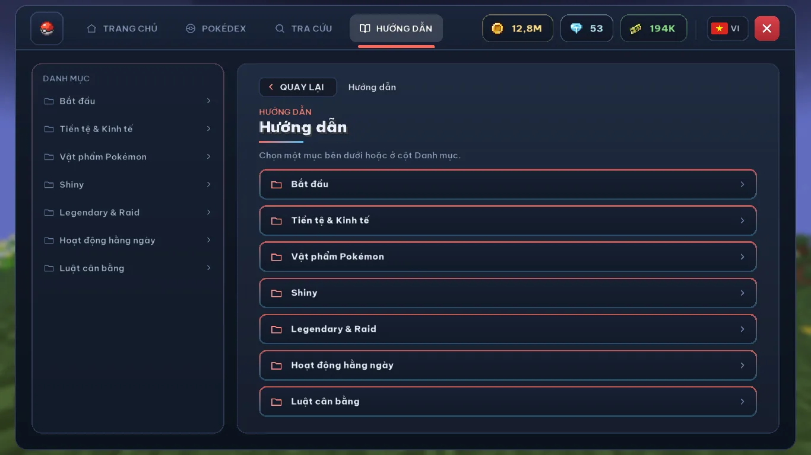



<h1 id="coco-cobblemon">Coco Cobblemon</h1>

Coco Cobblemon là server Minecraft Java chơi mod Cobblemon dành cho cộng đồng người Việt, vào game bằng launcher riêng CocoLauncher. Địa chỉ server: <code>coco.ultramc.co</code>, Minecraft Java 1.21.1, Cobblemon 1.7.3.

Địa chỉ server <code class="coco-ip__addr">coco.ultramc.co</code> <button type="button" class="coco-copy" data-copy="coco.ultramc.co" data-done="Đã chép"><svg aria-hidden="true"><use href="#ci-content-copy"/></svg>Sao chép</button>

<a class="coco-btn coco-btn--green" href="/cocolauncher/"><svg aria-hidden="true"><use href="#ci-download"/></svg>Tải CocoLauncher</a>
<a class="coco-btn coco-btn--purple" href="https://discord.gg/hyspace"><svg aria-hidden="true"><use href="#ci-forum"/></svg>Vào Discord</a>
<a class="coco-btn coco-btn--ghost" href="/cach-vao-server/"><svg aria-hidden="true"><use href="#ci-login"/></svg>Cách vào server</a>

CocoLauncher cho Windows, macOS, <a href="/cobblemon-dien-thoai/">Android</a>, <a href="/cobblemon-ios/">iPhone</a> (Android và iPhone là bản thử nghiệm).

| Mục | Thông tin |
|---|---|
| **Địa chỉ server** | `coco.ultramc.co` |
| **Phiên bản** | Minecraft Java 1.21.1, Fabric, Cobblemon 1.7.3 |
| **Máy chủ** | Đặt ở Singapore, ping khoảng 29 ms từ TP.HCM (đo 06/11/2026) |
| **Ngôn ngữ** | Tiếng Việt, có tiếng Anh trong launcher và menu (`/ngonngu en`) |
| **Vào game bằng** | CocoLauncher cho Windows, macOS, Android, iPhone (Android và iPhone là bản thử nghiệm) |
| **Chi phí** | Tải launcher và vào server không mất phí. Rank và Battle Pass Premium không bắt buộc |
| **Discord** | [discord.gg/hyspace](https://discord.gg/hyspace) (tên server Discord: Hyper Space) |
| **Số người chơi** | 110 người online lúc 20:28 Thứ 7, 07/11/2026 ([mcsrvstat.us](https://mcsrvstat.us/java/coco.ultramc.co)); Discord Hyper Space khoảng 1.860 thành viên (11/11/2026) |
| **Tên khác** | Coco's Hyper Space, Coco Cobbleverse (tên trong vài video, bài Facebook cũ) |

## Coco Cobblemon và CocoLauncher là gì?

Coco Cobblemon là server Minecraft Java chơi mod Cobblemon (mod Pokémon cho Minecraft) dành cho cộng đồng người Việt. Địa chỉ server là `coco.ultramc.co`, chạy Minecraft Java 1.21.1, Fabric và Cobblemon 1.7.3. Máy chủ đặt ở Singapore, ping khoảng 29 ms từ TP.HCM (đo 06/11/2026). Menu, hướng dẫn và thông báo bằng tiếng Việt, có tiếng Anh. Tải launcher và vào server không mất phí.

CocoLauncher (viết tách: Coco Launcher) là launcher Minecraft Java cài trên máy để vào server Coco Cobblemon, do Coconubs phát hành trên Microsoft Store và GitHub Releases. Launcher tự cài Java, Minecraft, Fabric và gói mod. CocoLauncher không phải app giao diện điện thoại (launcher Android) cũng tên "Coco Launcher".

Coco Cobblemon là server cộng đồng, không phải sản phẩm chính thức và không được xác nhận bởi Mojang, Microsoft, Nintendo, The Pokémon Company hay nhóm phát triển Cobblemon.

## Bắt đầu từ đâu

| Bạn muốn | Đọc trang |
|---|---|
| Tải launcher cho máy tính | [CocoLauncher (Coco Launcher)](/cocolauncher/) |
| Chơi trên điện thoại | [Chơi Cobblemon trên điện thoại Android, iPhone](/cobblemon-dien-thoai/) |
| Vào server lần đầu | [Cách vào server Coco Cobblemon](/cach-vao-server/) |
| Biết nên làm gì ngày đầu, lệnh hay dùng | [Hướng dẫn người mới](/huong-dan-nguoi-moi/) |
| Xem server có gì | [Tính năng](/tinh-nang/) |
| Launcher báo lỗi | [Sửa lỗi CocoLauncher](/cocolauncher/sua-loi/) |
| Câu hỏi thường gặp | [Hỏi đáp](/hoi-dap/) |

## Server Coco Cobblemon có gì?

<ul class="coco-cards">
<li>
<svg aria-hidden="true"><use href="#ci-swords"/></svg>
<h3><a href="/tinh-nang/dau-xep-hang/">Đấu Xếp Hạng</a></h3>
Đấu Đôi 4v4 tính Elo, Đấu Đơn 6v6, ghép trận tự động.

</li>
<li>
<svg aria-hidden="true"><use href="#ci-castle"/></svg>
<h3><a href="/tinh-nang/battletower/">BattleTower</a></h3>
555 tầng, cứ 5 tầng có 1 tầng boss.

</li>
<li>
<svg aria-hidden="true"><use href="#ci-groups"/></svg>
<h3><a href="/tinh-nang/bang-hoi/">Bang hội</a></h3>
Bang Hội Chiến từ Thứ 2 tới Thứ 6, Boss Bang mỗi ngày, Quà Bang, khoá đất riêng.

</li>
<li>

<h3><a href="/tinh-nang/raid/">Raid Thế Giới</a></h3>
Boss chung cả server lúc 9:00 và 19:00 mỗi ngày.

</li>
<li>

<h3><a href="/tinh-nang/legendary/">Legendary tích luỹ</a></h3>
Server càng lâu chưa có Legendary thì tỉ lệ càng tăng, Giờ Vàng cuối tuần 20h-22h.

</li>
<li>

<h3><a href="/tinh-nang/shiny/">Shiny</a></h3>
Dung hợp Shiny, Trứng Pokémon, Raid, Daily Shop, Battle Pass.

</li>
<li>
<svg aria-hidden="true"><use href="#ci-calendar-month"/></svg>
<h3><a href="/tinh-nang/hang-ngay/">Việc hằng ngày</a></h3>
Battle Pass, Nghề nghiệp, Ải Viễn Chinh, Daily Shop, điểm danh.

</li>
<li>
<svg aria-hidden="true"><use href="#ci-phishing"/></svg>
<h3><a href="/tinh-nang/cau-ca/">Câu cá</a></h3>
100 loài cá, sách sưu tập, khung giờ vàng mỗi tối.

</li>
<li>
<svg aria-hidden="true"><use href="#ci-stadium"/></svg>
<h3><a href="/tinh-nang/gym-npc/">Gym và NPC Tiền Thưởng</a></h3>
Gym có mốc cấp, Tứ Thiên Vương, Champion, NPC Tiền Thưởng cấp 100 mỗi ngày.

</li>
<li>
<svg aria-hidden="true"><use href="#ci-paid"/></svg>
<h3><a href="/tinh-nang/kinh-te/">Tiền tệ, Shop, Chợ GTS</a></h3>
CobbleDollars, Tokens, Held Item mua bằng Tokens, mua bán Pokémon qua <code>/gts</code>.

</li>
<li>

<h3><a href="/tinh-nang/breeding/">Breeding</a></h3>
Lấy trứng bằng Pasture, nhanh hơn trong đất bang.

</li>
<li>
<svg aria-hidden="true"><use href="#ci-cottage"/></svg>
<h3><a href="/tinh-nang/dat-nha/">Đất và nhà</a></h3>
<code>/claim</code> giữ đất, khoá đất riêng, <code>/sethome</code>, <code>/rtp</code>.

</li>
</ul>

## Ảnh trong game

Menu, hướng dẫn và thông báo trong game đều bằng tiếng Việt, có tiếng Anh (`/ngonngu en`).

<figure class="coco-gallery__wide"><figcaption>Menu chính trong game: mỗi ô mở một tính năng, ví dụ Daily Shop, Viễn Chinh, Câu cá, Bang hội, Dung hợp, Chợ GTS.</figcaption></figure>
<figure><figcaption>Câu cá: bán cá, kho cá, sách sưu tập, chế tạo cần câu và khung giờ vàng 19:00-22:00.</figcaption></figure>
<figure><figcaption>Hướng dẫn trong game chia theo mục: bắt đầu, tiền tệ, vật phẩm Pokémon, Shiny, Legendary và Raid.</figcaption></figure>

*Ảnh giao diện menu trong game, ngày 28/10 và 30/10/2026. Số trên thanh trên cùng là số dư của tài khoản dùng để chụp.*

## Tìm hiểu thêm về Cobblemon

- [Cobblemon là gì? Mod Pokémon cho Minecraft Java](/cobblemon-la-gi/)
- [Server Cobblemon Việt Nam](/server-cobblemon-viet-nam/)
- [Launcher nào để chơi Cobblemon](/launcher-cobblemon/)
- [Cách tải Cobblemon cho Minecraft Java](/cach-tai-cobblemon/)
- [Các phím chơi Cobblemon: phím tắt mặc định](/phim-tat-cobblemon/)
- [Lệnh Cobblemon: /pokespawn, /pokegive, /pokeheal](/lenh-cobblemon/)
- [Công thức chế tạo Cobblemon: Poké Ball, PC, máy hồi máu](/cong-thuc-cobblemon/)
- [Cách bắt Pokémon trong Cobblemon: tỉ lệ bắt, loại bóng, Legendary](/cach-bat-pokemon-cobblemon/)
- [Cách tiến hoá Pokémon trong Cobblemon: đá, trao đổi, Link Cable, Eevee](/tien-hoa-cobblemon/)
- [Cách tiến hoá Mega trong Cobblemon: Mega Bracelet, đá Mega, Rayquaza](/mega-cobblemon/)
- [Cách cưỡi Pokémon trong Cobblemon: Pokémon nào cưỡi được](/cuoi-pokemon-cobblemon/)
- [Cách học chiêu cho Pokémon trong Cobblemon: Đổi Đòn, TM](/hoc-chieu-cobblemon/)
- [Cobblemon Việt hoá: chơi bằng tiếng Việt](/cobblemon-viet-hoa/)
- [Cobblemon PE, Bedrock: có bản cho Minecraft PE không?](/cobblemon-pe/)
- [Cobblemon trên iPhone, iPad (iOS)](/cobblemon-ios/)
- [Chơi Pokémon trong Minecraft: Cobblemon và Pixelmon](/pokemon-trong-minecraft/)
- [Nhật ký cập nhật](/cap-nhat/): màn Đăng nhập mới, nút RTP trong menu (11/11/2026)
{: .coco-links }

*Cập nhật: 11/11/2026.*
