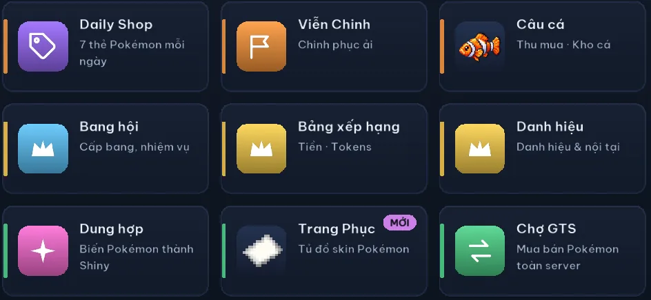
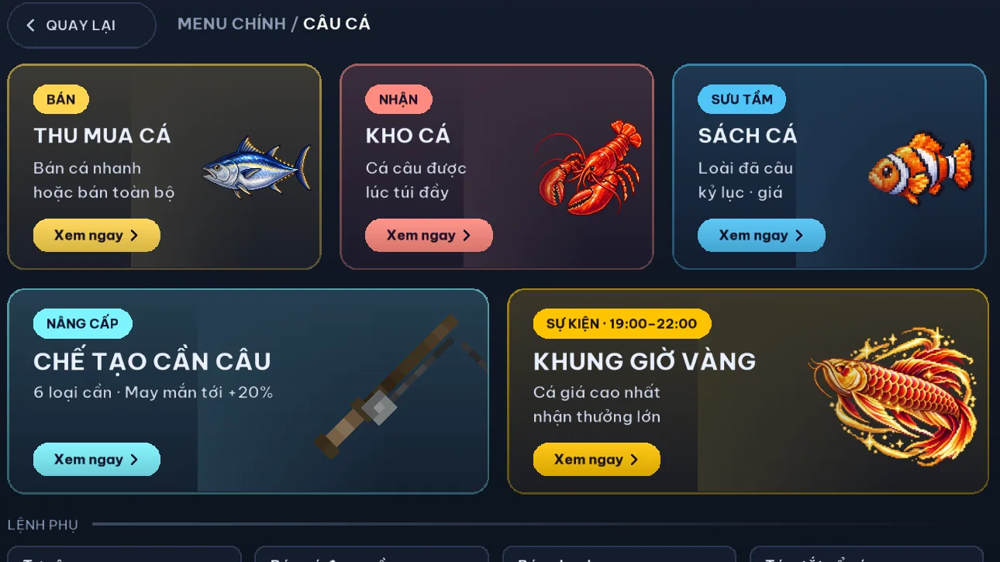
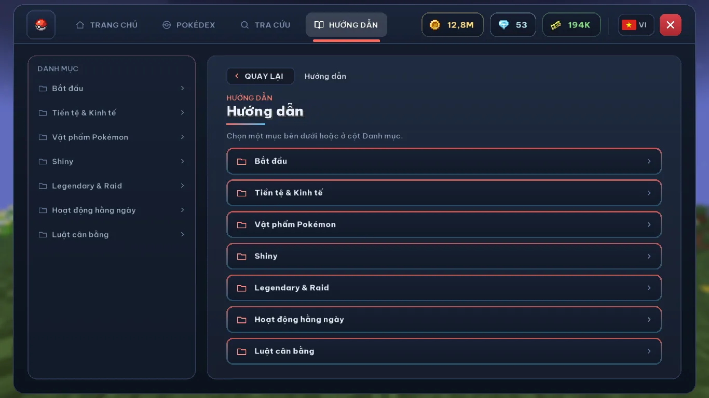

# Tính năng Coco Cobblemon

Coco Cobblemon là server Minecraft Java chơi mod Cobblemon dành cho cộng đồng người Việt. Trang này tổng hợp các hệ thống chính của server, lấy từ Hướng dẫn trong game.
{: .fs-5 .fw-300 }

## Đấu trận

| Tính năng | Tóm tắt |
|---|---|
| [Đấu Xếp Hạng](/tinh-nang/dau-xep-hang/) | Đấu Đôi 4v4 tính Elo (thể thức chính), Đấu Đơn 6v6. Ghép ẩn theo Elo, hạng Đồng tới Cao Thủ, top 5 là Thách Đấu |
| [BattleTower](/tinh-nang/battletower/) | 555 tầng, đấu 6v6 với NPC, cứ 5 tầng có 1 tầng boss dùng Mega, Dynamax, Tera, Z-Move |
| [Gym, Tứ Thiên Vương, Champion](/tinh-nang/gym-npc/) | Mỗi trận có mốc cấp riêng, Pokémon cao hơn mốc được hạ về đúng mốc trong trận (bản sao, Pokémon thật không đổi). Đội NPC IV tối đa, AI mạnh nhất |
| [NPC Tiền Thưởng](/tinh-nang/gym-npc/#npc-tien-thuong) | Mỗi ngày 1 NPC cấp 100 xuất hiện ngẫu nhiên từ 7:00 tới 22:00, đội được chọn để khắc đội bạn. Tra bằng `/tienthuong` |
| [Raid Thế Giới](/tinh-nang/raid/) | Boss chung cả server lúc 9:00 và 19:00, top 5 sát thương được bắt boss |

## Bắt Pokémon

| Tính năng | Tóm tắt |
|---|---|
| [Legendary tích luỹ](/tinh-nang/legendary/) | Tỉ lệ khởi đầu 0,001%, cứ 20 phút server chưa có Legendary thì +0,001%, tối đa 1%. Giờ Vàng cuối tuần x2 |
| [Shiny](/tinh-nang/shiny/) | Không xuất hiện tự nhiên. Có qua Dung hợp Shiny, Trứng, Raid, Daily Shop, Battle Pass |
| Trứng Pokémon | Ba loại: Thường (cấp 5), Quý (cấp 30), Huyền Thoại (cấp 50) |
| Trang Phục | Skin đổi ngoại hình Pokémon, không đổi chỉ số. Mở bằng `/trangphuc` |

Cách bắt, tiến hoá, cưỡi Pokémon và dùng Mega trên server: [Cách bắt Pokémon](/cach-bat-pokemon-cobblemon/) · [Cách tiến hoá](/tien-hoa-cobblemon/) · [Tiến hoá Mega](/mega-cobblemon/) · [Cách cưỡi Pokémon](/cuoi-pokemon-cobblemon/) · [Cách học chiêu](/hoc-chieu-cobblemon/)

## Bang hội

| Tính năng | Tóm tắt |
|---|---|
| [Bang Hội Chiến](/tinh-nang/bang-hoi/#bang-hoi-chien) | Thứ 2 tới Thứ 6, 9h-22h. Treo Cờ Chiến, khiêu chiến cướp cờ, Đấu Đôi 4v4. Giữ nhiều cờ nhất lúc 22h là Bá chủ |
| [Boss Bang](/tinh-nang/bang-hoi/#boss-bang) | Mỗi ngày 1 boss mới cho mọi bang, mỗi người 3 lượt |
| [Quà Bang](/tinh-nang/bang-hoi/#qua-bang) | Thành viên bắt Shiny, Legendary hay vượt mốc BattleTower thì cả bang nhận quà |
| Khoá đất riêng | `/dat khoa`: chỉ bạn và tối đa 30 người tin cậy dùng được đất của bạn |

## Việc hằng ngày

| Tính năng | Tóm tắt |
|---|---|
| [Battle Pass](/tinh-nang/hang-ngay/#battle-pass) | 100 cấp, 10 nhiệm vụ ngày và 10 nhiệm vụ tuần, pass thường có quà mỗi 5 cấp cho mọi người |
| [Nghề nghiệp](/tinh-nang/hang-ngay/#nghe-nghiep) | 8 nghề, mỗi ngày 5 nhiệm vụ mỗi nghề, thưởng 1.000$ tới 10.000$ |
| [Ải Viễn Chinh](/tinh-nang/hang-ngay/#vien-chinh) | Gửi Pokémon đi ải 1★ tới 5★, 3 lượt mỗi ngày |
| [Daily Shop](/tinh-nang/hang-ngay/#daily-shop) | 7 thẻ Pokémon cấp 50 mỗi ngày, tỉ lệ Shiny 1/2048 |
| [Điểm danh](/tinh-nang/hang-ngay/#diem-danh) | Chuỗi ngày liên tiếp nhận Tokens, Trứng, Tinh Thể Shiny |
| [Câu cá](/tinh-nang/cau-ca/) | 100 loài cá, 7 độ hiếm, sách sưu tập, khung giờ vàng 19:00-22:00 |
| [Tiền tệ, Shop, Chợ GTS](/tinh-nang/kinh-te/) | CobbleDollars, Tokens, BattleTower Points. Held Item, thuốc EV, Mint, kẹo IV mua bằng Tokens; Chợ GTS mua bán giữa người chơi (`/gts`, `/ah`) |
| [Breeding](/tinh-nang/breeding/) | Lấy trứng bằng Pasture Block, khoảng 4-8 giờ 1 trứng, nhanh hơn trong đất bang |
| [Đất, nhà, dịch chuyển](/tinh-nang/dat-nha/) | `/claim` theo chunk, khoá đất riêng `/dat khoa`, `/sethome`, `/rtp`, Waystone. Ngoài ±30.000 không claim được |
| Túi May Mắn | Rơi khi bắt Pokémon, thắng trận, đào quặng, câu cá |
| Mini-game | Tiến Lên, Cờ Tỷ Phú, Cờ Vua (tính Elo) |

## Tiếng Việt

Launcher, Menu và Hướng dẫn của Coco bằng tiếng Việt, kèm nút chọn tiếng Anh. Một số nội dung của Cobblemon và mod khác vẫn có thể hiện tiếng Anh. Xem thêm [Cobblemon Việt hoá](/cobblemon-viet-hoa/).

## Ảnh trong game

<figure class="coco-gallery__wide"><figcaption>Menu chính trong game: mỗi ô mở một tính năng, ví dụ Daily Shop, Viễn Chinh, Câu cá, Bang hội, Dung hợp, Chợ GTS.</figcaption></figure>
<figure><figcaption>Câu cá: bán cá, kho cá, sách sưu tập, chế tạo cần câu và khung giờ vàng 19:00-22:00.</figcaption></figure>
<figure><figcaption>Hướng dẫn trong game chia theo mục: bắt đầu, tiền tệ, vật phẩm Pokémon, Shiny, Legendary và Raid.</figcaption></figure>

*Ảnh giao diện menu trong game, ngày 28/10 và 30/10/2026. Số trên thanh trên cùng là số dư của tài khoản dùng để chụp.*

## Hỏi nhanh

### Server Coco Cobblemon có những hoạt động nào?

Đấu Xếp Hạng tính Elo, BattleTower 555 tầng, Gym, Tứ Thiên Vương, Champion và NPC Tiền Thưởng; Raid Thế Giới; Legendary tích luỹ và nhiều cách có Shiny (Dung hợp, Trứng, Raid, Daily Shop, Battle Pass); bang hội với Bang Hội Chiến, Boss Bang, Quà Bang; việc hằng ngày: Battle Pass, Nghề nghiệp, Ải Viễn Chinh, Daily Shop, điểm danh; câu cá 100 loài, Breeding, đất và nhà, Chợ GTS.

### Hoạt động nào có giờ cố định?

Theo giờ Việt Nam: Raid Thế Giới lúc 9:00 và 19:00 mỗi ngày; Bang Hội Chiến Thứ 2 tới Thứ 6, 9h-22h; khung giờ vàng câu cá 19:00-22:00 mỗi tối; Giờ Vàng Legendary Thứ 7 và Chủ Nhật, 20:00-22:00. Boss Bang mới, nhiệm vụ ngày Battle Pass, Nghề nghiệp, Ải Viễn Chinh và Daily Shop làm mới lúc 0h00.

*Nội dung lấy từ Hướng dẫn trong game ngày 06/11/2026.*
